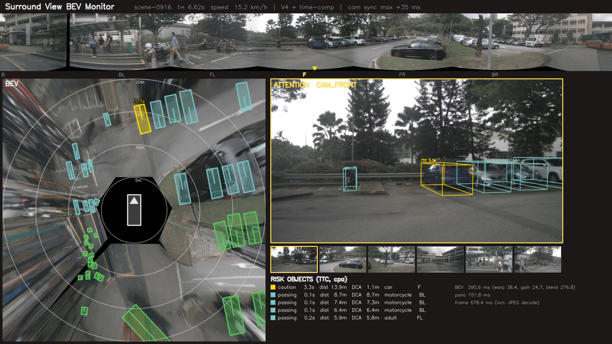
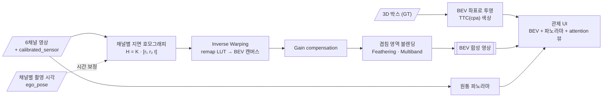
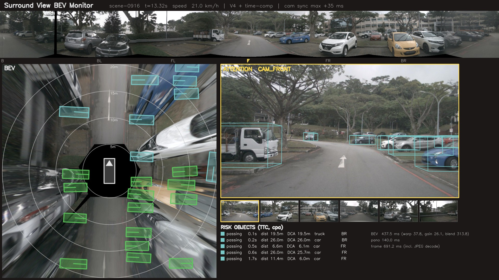
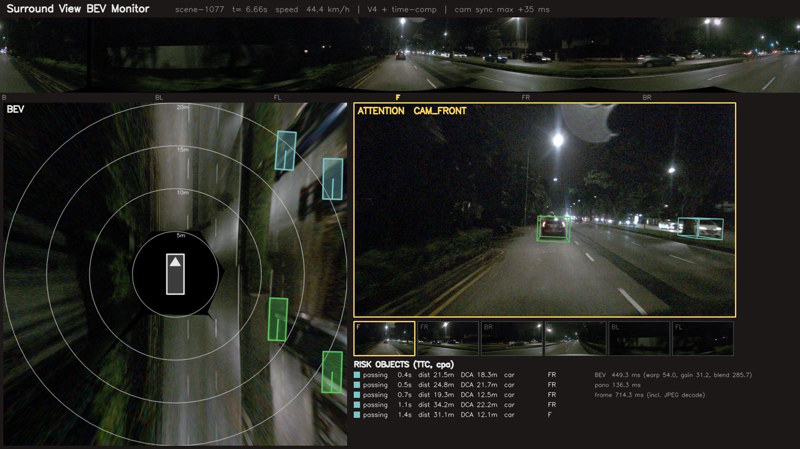

<div align="center">

# 🛰️ Surround View BEV Monitor

**원격 관제를 위한 6채널 카메라 서라운드 뷰 · 버드아이뷰(BEV) 합성**

-0F766E?style=flat-square)


> 원격 관제 화면에 카메라 6개를 격자로 늘어놓으면 오퍼레이터가 한눈에 상황을 파악하기 어렵습니다.<br/>
> 6개 영상을 **위에서 내려다본 한 장**으로 합치고, 그 위에 위험 객체를 표시합니다.



</div>

---

## 📌 문제 정의

[적응형 카메라 뷰 연구](https://github.com/cbnu-yhjeon/Adaptive-Camera-View-Selection-System)는 "어떤 뷰를 보여 줄지"를 다룹니다. 이 프로젝트는 그와 짝이 되는 질문, **"여러 뷰를 어떻게 하나로 보여 줄지"**를 다룹니다.

## 🎯 목표와 구현 현황

| # | 목표 | 산출물 | 상태 |
|:---:|---|---|:---:|
| G1 | 지면 평면 가정 IPM으로 6채널 BEV 합성 | [`src/bev/`](src/bev/) · [단일 채널 결과](results/single_channel/) | ✅ |
| G2 | 원통 투영 파노라마 스트립 | [`src/panorama/cylindrical.py`](src/panorama/cylindrical.py) · [파노라마](results/single_channel/panorama_multiband.jpg) | ✅ |
| G3 | 3D 박스(GT)를 BEV 위에 투영하고 TTC로 색 표시 | [`src/overlay/`](src/overlay/) · [관제 UI 데모](results/demo/) | ✅ (GT만, 검출기 없음) |
| G4 | 겹치는 영역 블렌딩 방식 비교 | [`results/blending/summary.md`](results/blending/summary.md) | ✅ |

---

## 🚀 빠른 시작

```bash
uv venv .venv -p 3.10 && uv pip install -p .venv/bin/python -r requirements.txt
export NUSCENES_ROOT=~/data/nuscenes          # 기본값. v1.0-mini 와 samples/ 가 있어야 함

.venv/bin/python -m pytest                     # 단위 + mini 통합 테스트 (18개)
.venv/bin/python scripts/01_single_channel.py  # 채널별 BEV, 6채널 V1, 원통 파노라마
.venv/bin/python scripts/02_compare_blending.py --stride 2   # V1–V4 비교 + 이음새 정렬
.venv/bin/python scripts/03_eval_geometry.py   # GT 박스 접지점 BEV 위치 오차
.venv/bin/python scripts/04_benchmark_speed.py # LUT 사전 계산 전후, 단계별 시간
.venv/bin/python scripts/05_make_demo.py       # 관제 UI 데모 영상 (12 Hz, 장면당 ~20초)
```

`nuscenes-devkit`은 쓰지 않습니다. devkit이 `numpy<2`를 고정해 다른 프로젝트와 충돌하므로
JSON 테이블을 직접 읽는 가벼운 로더([`src/data/nuscenes_lite.py`](src/data/nuscenes_lite.py))를 씁니다.

```python
from src.data import NuScenesLite
from src.bev.pipeline import SurroundBEV
from src.ui.monitor import MonitorRenderer

ns = NuScenesLite("v1.0-mini")
frame = ns.keyframes("scene-0061")[0]          # 또는 ns.sweeps(...) — 12 Hz, 박스 보간
bev = SurroundBEV(variant="V4", time_comp=True).compose(frame).bev
ui = MonitorRenderer(ns).render(frame)         # 1920×1080 관제 화면
```

---

## 🔗 기반 수업과 저장소

| 수업 / 프로젝트 | 가져온 것 | 구현 위치 |
|---|---|---|
| 산업 컴퓨터비전 Lec 9 | 호모그래피, Inverse Warping, 원통 투영, Feathering · Laplacian 다중 대역 블렌딩, Gain compensation | `bev/ground_homography.py` · `bev/warp.py` · `bev/blend.py` · `bev/gain.py` · `panorama/` |
| 산업 컴퓨터비전 Lec 10 | 내부·외부 파라미터, 좌표계 변환 | `calib/camera.py` |
| 산업 컴퓨터비전 Lec 8 | 특징 정합 → 이음새 어긋남 측정(위상 상관으로 대체) | `eval/metrics.py` |
| 영상처리 실체 | Perspective 변환 | `bev/warp.py` (`warpPerspective` 기준선) |
| 연구: 적응형 카메라 뷰 | 채널 순서, TTC(cpa) 정의, attention 뷰 점수 | `constants.py` · `overlay/ttc.py` · `overlay/box_projection.py` |

---

## 🧭 접근 방법



### 지면 호모그래피

```
p ≃ K_c · [R_c | t_c] · [x, y, 0, 1]ᵀ = K_c · [r₁  r₂  t_c] · [x, y, 1]ᵀ
→ H_c = K_c · [r₁  r₂  t_c]            (3×3, 지면 → 영상)
BEV 픽셀 (u, v) → 지면 (x, y) 를 S로 두면,   BEV(u, v) = I_c( H_c · S · [u, v, 1]ᵀ )
```

`R_c`, `t_c`는 nuScenes `calibrated_sensor`(카메라 → 자차)를 뒤집어서 얻습니다. BEV 캔버스는 기본
40 m × 40 m, 5 cm/px(800×800), 위쪽이 전방입니다.

### 구현 세부 결정

| 항목 | 결정 | 이유 |
|---|---|---|
| 기준 시각 | CAM_FRONT 타임스탬프와 자세 | 6채널은 최대 ±35 ms 어긋나게 촬영됨 |
| 시간 보정 (선택) | `T_cam←ref = T_cam←ego · T_ego(t_c)←global · T_global←ego(t_ref)` 로 채널마다 호모그래피 재계산 | 고속 주행 시 채널 간 자차 이동(10 m/s × 35 ms ≈ 0.35 m) |
| 차체 가림 | 자차 외곽 + 0.2 m 제외, CAM_BACK 하단 60행(트렁크 범퍼) 제외 | 범퍼가 지면으로 펴져 원호 모양 잡음이 생김 |
| 블렌딩 가중치 | 마스크 경계까지의 distance transform | 경계에서 0이 되어 이음새가 자연스럽게 사라짐 |
| 다중 대역 | 최대 가중 채널 이진 마스크(Brown & Lowe), 5단계, 채널별 ROI만 분해 | 고주파는 한 채널에서만 → ghost 없음. ROI로 1.2 s → ~0.1 s |
| 무효 영역 채움 | pull-push로 워핑 영상 바깥을 주변 값으로 채운 뒤 피라미드 | 검정 테두리가 저주파 대역을 타고 번지는 것 방지 |
| Gain | Brown & Lowe 식, σ_N = 10, σ_g = 0.1, 색 채널별 6×6 선형계. UI에서는 프레임 간 EMA(α = 0.3) | 이득 깜빡임 방지 |
| TTC | 형제 연구의 cpa 정의, DCA > (자차 반폭 + 객체 반폭 + 0.5 m) 이면 "passing" | 길가 주차 차량을 충돌 임박으로 오판하지 않음 |
| attention 뷰 | 채널 점수 Σ exp(−TTC/3 s), 위험 없으면 CAM_FRONT | 형제 연구의 위험도 항 |
| sweep 데모 | CAM_FRONT 12 Hz 기준 최근접 타임스탬프로 묶고, 박스는 keyframe 사이 선형 보간 | 2 Hz keyframe만으로는 영상이 끊김 |

---

## 📊 결과 (nuScenes v1.0-mini)

### G4 — 블렌딩 V1–V4 (10개 장면, keyframe 1/2 표본, 205 프레임)

| 변형 | 블렌딩 | 노출 보정 | 겹침 광도 차 ↓ | 이음새 계단비 ↓ | 겹침 선명도 (1 = 원본) | 합성 시간 (ms) |
|:---:|---|:---:|---:|---:|---:|---:|
| V1 | 덮어쓰기 | — | 29.3 | 6.28 | 1.06 | 49 |
| V2 | Feathering | — | 29.3 | **1.05** | 0.84 | 67 |
| V3 | Laplacian 5단계 | — | 29.3 | 1.37 | 1.02 | 150 |
| V4 | V3 + Gain | ✅ | **22.6** | 1.37 | **1.01** | 175 |

- **겹침 광도 차**: 겹침 영역의 두 채널 밝기 평균 절대차(0–255). 블렌딩 이전 지표라 V1–V3이 같고, Gain compensation이 23% 줄입니다(주간 34.1 → 24.9, 야간 17.9 → 17.0).
  남는 차이의 상당 부분은 노출이 아니라 **높이 있는 물체의 시차**(IPM은 지면만 정확)입니다.
- **이음새 계단비**: 이음새를 가로지르는 이웃 픽셀 밝기 차 ÷ 이음새가 아닌 곳의 밝기 차. 1이면 이음새가 안 보입니다.
  V1은 6.3배로 이음새가 뚜렷하고, 블렌딩 셋 다 1 근처로 떨어집니다.
- **겹침 선명도**: 겹침 영역 |Laplacian|을 담당 채널 원본과 비교. **Feathering은 이음새는 가장 매끈하지만 고주파가 16% 깎입니다**(어긋난 차선이 이중상으로 겹침). 다중 대역은 선명도를 유지합니다 → **V4를 최종안으로** 씁니다.
- 비교 그림: [주간](results/blending/compare_day_scene-0061.jpg) · [야간](results/blending/compare_night_scene-1077.jpg)

### 이음새 정렬 — 겹침 영역 위상 상관 (자차 반경 20 m)

| 시간 보정 | 채널쌍 표본 | 어긋남 중앙값 | 평균 | 고속(>5 m/s) 중앙값 |
|:---:|---:|---:|---:|---:|
| 끔 | 669 | 0.157 m (3.1 px) | 0.263 m | 0.196 m |
| 켬 | 691 | 0.162 m (3.2 px) | 0.248 m | 0.188 m |

시간 보정은 평균·고속 구간에서 조금 줄이지만 중앙값은 그대로입니다. 겹침 영역의 남은 어긋남은 채널 간
촬영 시각 차보다 **캘리브레이션 오차와 노면 기울기**가 지배적이라는 뜻입니다. 개별 사례에서는 효과가 큽니다
(scene-0061, 9 m/s: BACK_LEFT–FRONT_LEFT 1.57 m → 0.33 m).

### 기하 정확도 — GT 박스 접지점의 BEV 위치 오차 (7,733개 박스)

GT 박스 바닥 중심을 그 박스가 보이는 채널의 **촬영 시각 자세**로 영상에 투영(= 실제로 찍힌 위치)한 뒤,
IPM으로 되돌린 위치와 기준 시각 참 위치를 비교합니다. 접지 높이는 박스 바닥을 쓰며, 15 m 이내에서
LiDAR 지면과의 중앙 차는 0.088 m입니다.

| 구간 | n | 정적 캘리브 중앙값 / p90 (m) | + 시간 보정 | + 참 지면 높이 (oracle) |
|---|---:|---:|---:|---:|
| 전체 | 7733 | 2.73 / 14.3 | 2.71 / 14.2 | 0.03 / 0.08 |
| 거리 < 10 m | 1007 | 0.51 / 1.90 | 0.50 / 1.89 | 0.03 / 0.07 |
| 거리 10–20 m | 3089 | 1.92 / 6.87 | 1.90 / 6.79 | 0.03 / 0.09 |
| 거리 ≥ 20 m | 3637 | 5.48 / 25.2 | 5.47 / 25.1 | 0.03 / 0.09 |
| 평지(접지 높이 ±0.15 m 이내) | 2699 | 0.57 / 1.65 | 0.56 / 1.62 | 0.02 / 0.08 |
| 평지 & 10 m 이내 | 679 | 0.29 / 0.67 | **0.26 / 0.66** | 0.02 / 0.06 |
| 평지 & 고속(≥ 8 m/s) | 754 | 0.67 / 1.75 | 0.62 / 1.67 | 0.03 / 0.14 |
| 비평지(±0.15 m 밖) | 5034 | 4.87 / 22.1 | 4.85 / 22.1 | 0.03 / 0.09 |

**오차의 거의 전부가 평지 가정에서 나옵니다.** 참 지면 높이를 주면 오차가 3 cm로 떨어지고, 박스의 65%는
자차 지면에서 ±15 cm 넘게 떨어져 있습니다(인도 턱, 경사). 지면 높이 오차 Δz는 카메라 높이 h ≈ 1.5 m에서
거리 d를 d·Δz/(h−Δz)만큼 늘리므로 원거리일수록 커집니다. 그래서 **BEV 영상 위치 대신 3D 박스를 직접 그려
덧씌우는 것**(G3)이 관제 화면에서 필요합니다. 시간 보정은 평지·고속 구간에서 중앙값을 7% 줄입니다.

### 속도 (6채널, JPEG 디코딩 제외)

| | 800×800 (5 cm) | 400×400 (10 cm) |
|---|---:|---:|
| 워핑: 매 프레임 좌표 계산 + remap | 28.5 ms | 6.9 ms |
| 워핑: `warpPerspective` | **3.4 ms** | **2.4 ms** |
| 워핑: 사전 계산 LUT `remap` (float / fixed) | 6.4 / 6.6 ms | 3.1 / 2.9 ms |
| 전체 V1 / V4 | 32 / 220 ms | 9 / 32 ms |
| 전체 V4 + 시간 보정 | 155 ms | 42 ms |

> ⚠️ 측정 당시 다른 학습 프로세스로 load average가 ~20(12코어)이어서 V2–V4의 800×800 수치는 변동이 큽니다
> (p10–p90은 [`results/speed/summary.md`](results/speed/summary.md)).

- LUT 사전 계산은 매 프레임 좌표 계산 대비 **4.5배**(800×800) 빠릅니다. 다만 OpenCV `warpPerspective`가
  좌표를 SIMD로 즉석 계산해 LUT `remap`(메모리 대역폭 제한)보다도 빠릅니다. 호모그래피만 쓰는 지금은
  **`warpPerspective` + 고정 마스크**가 가장 빠르고, LUT는 렌즈 왜곡 보정처럼 비선형 매핑이 들어갈 때 이득입니다.
- 병목은 워핑이 아니라 **다중 대역 블렌딩**입니다. 10 cm/px에서는 V4 + 시간 보정이 42 ms(≈ 24 fps)로 실시간 관제에 충분합니다.

### 데모

`scripts/05_make_demo.py`가 장면마다 12 Hz 관제 화면 영상(1280×720)을 만듭니다. 저장소에는
[`scene-0553.mp4`](results/demo/scene-0553.mp4)와 장면별 스냅숏만 넣었습니다(나머지 영상은 같은 명령으로 재생성).

| 주간 · 주차장 (scene-0916) | 야간 · 고속 (scene-1077) |
|---|---|
|  |  |

---

## 🗂️ 데이터

| 데이터 | 용도 | 비고 |
|---|---|---|
| [nuScenes](https://www.nuscenes.org/) `v1.0-mini` | 개발 · 데모 · 위 결과 전부 | 6채널 카메라, 캘리브레이션, 3D GT, LiDAR |
| nuScenes `v1.0-trainval` (일부) | 정량 평가 확장 | `02`·`03`·`05` 스크립트가 `--version v1.0-trainval --scenes ...` 지원 |

> nuScenes는 **CC BY-NC-SA 4.0**(비상업)입니다.

## 📁 디렉토리 구조

```
Surround-View-BEV-Monitor/
├── src/
│   ├── data/nuscenes_lite.py   JSON 테이블 로더 · keyframe/sweep 프레임 묶기 · 박스 보간 · LiDAR
│   ├── calib/camera.py         쿼터니언 → R, Pose, CameraModel (K, 외부 파라미터, 투영)
│   ├── bev/                    ground_homography · warp(LUT) · blend · gain · pipeline(V1–V4)
│   ├── panorama/cylindrical.py 원통 투영 360° 스트립
│   ├── overlay/                ttc(cpa) · box_projection(TTC 색상, attention 뷰)
│   ├── eval/metrics.py         광도 차 · 이음새 계단비 · 선명도 · 위상 상관 정렬
│   └── ui/monitor.py           관제 화면 렌더러
├── scripts/                    01–05 실험·데모 실행 스크립트
├── tests/                      기하·블렌딩·Gain·TTC 단위 테스트 + mini 통합 테스트
└── results/                    single_channel · blending · geometry · speed · demo
```

## ⚠️ 한계와 다음 단계

| 항목 | 현재 | 다음 단계 |
|---|---|---|
| 평지 가정 | 비평지 객체에서 중앙 4.9 m 오차 (위 표) | LiDAR 지면 맞춤으로 국소 지면 높이 반영 BEV, 경사 구간 표시 |
| 검출 | GT 박스만 | 카메라 3D 검출기(BEVFormer 계열) 출력을 같은 `Box` 인터페이스로 연결 |
| 사각지대 | 자차 주변 ~3 m는 어떤 카메라도 지면을 못 봄(BEV 중앙의 검은 영역) | 차량 아이콘으로 가림; 실제 차량은 하향 어안 카메라 필요 |
| 속도 | 5 cm/px V4 ≈ 6 fps (부하 상태) | 다중 대역 GPU 구현(torch), 피라미드 단계 축소 |
| 사용성 실험 | 미실시 | 6분할 격자 vs BEV 위험 객체 탐색 시간 비교 |
| trainval 평가 | mini만 | `--version v1.0-trainval` 로 일부 장면 확장 |

## 📚 참고 자료

- M. Brown, D. Lowe, *Automatic Panoramic Image Stitching using Invariant Features*, IJCV 2007
- P. Burt, E. Adelson, *A Multiresolution Spline with Application to Image Mosaics*, 1983
- R. Hartley, A. Zisserman, *Multiple View Geometry in Computer Vision*
- 산업 컴퓨터비전 Lec 8 · 9 · 10 강의 자료
