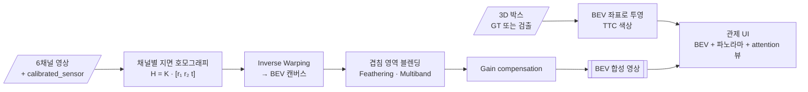

<div align="center">

# 🛰️ Surround View BEV Monitor

**원격 관제를 위한 6채널 카메라 서라운드 뷰 · 버드아이뷰(BEV) 합성**


> 원격 관제 화면에 카메라 6개를 격자로 늘어놓으면 오퍼레이터가 한눈에 상황을 파악하기 어렵습니다.<br/>
> 6개 영상을 **위에서 내려다본 한 장**으로 합치고, 그 위에 위험 객체를 표시합니다.

</div>

> [!NOTE]
> 🚧 **계획 단계입니다.** 아직 코드가 없고, 이 README는 프로젝트 설계서입니다.

---

## 📌 문제 정의

[적응형 카메라 뷰 연구](https://github.com/cbnu-yhjeon/Adaptive-Camera-View-Selection-System)는 "어떤 뷰를 보여 줄지"를 다룹니다. 이 프로젝트는 그와 짝이 되는 질문, **"여러 뷰를 어떻게 하나로 보여 줄지"**를 다룹니다.

## 🎯 목표

| # | 목표 | 산출물 |
|:---:|---|---|
| G1 | 지면 평면 가정 IPM으로 6채널 BEV 합성 | 실시간 BEV 영상 |
| G2 | 원통 투영 파노라마 스트립 | 360° 띠 영상 |
| G3 | 3D 박스(GT 또는 검출)를 BEV 위에 투영하고 TTC로 색 표시 | 관제 UI 데모 |
| G4 | 겹치는 영역 블렌딩 방식 비교 | 이음새 품질 지표 |

---

## 🔗 기반 수업과 저장소

| 수업 / 프로젝트 | 가져올 것 | 저장소 |
|---|---|---|
| 산업 컴퓨터비전 Lec 9 | 호모그래피, Forward/Inverse Warping, 원통 투영, Feathering · 다중 대역(Laplacian) 블렌딩, Gain compensation | [industrial_computor_vision](https://github.com/cbnu-yhjeon/industrial_computor_vision) |
| 산업 컴퓨터비전 Lec 10 | 내부·외부 파라미터, 좌표계 변환 | 〃 |
| 산업 컴퓨터비전 Lec 8 | 특징 매칭, RANSAC (이음새 정합 보정) | 〃 |
| 영상처리 실체 | Affine · Perspective 변환 | [Image-Processing-Entities](https://github.com/cbnu-yhjeon/Image-Processing-Entities) |
| 연구: 적응형 카메라 뷰 | nuScenes 로더, 채널 순서, TTC 정의, attention 뷰 출력 | [Adaptive-Camera-View-Selection-System](https://github.com/cbnu-yhjeon/Adaptive-Camera-View-Selection-System) |

---

## 🧭 접근 방법



### 지면 호모그래피

자차 좌표계의 지면(`z = 0`) 위 점 `(x, y)`는 카메라 `c`의 영상 좌표로 다음처럼 투영됩니다.

```
p ≃ K_c · [R_c | t_c] · [x, y, 0, 1]ᵀ = K_c · [r₁  r₂  t_c] · [x, y, 1]ᵀ
→ H_c = K_c · [r₁  r₂  t_c]            (3×3, 지면 → 영상)
BEV 픽셀 (u, v) → 지면 (x, y) 를 S로 두면,   BEV(u, v) = I_c( H_c · S · [u, v, 1]ᵀ )
```

`K_c`, `R_c`, `t_c`는 nuScenes `calibrated_sensor`(카메라 → 자차)를 뒤집어서 얻습니다.

### 알려진 한계와 보완
- IPM은 **지면만 정확합니다.** 차량·보행자처럼 높이가 있는 물체는 길게 늘어져 보입니다. 그래서 3D 박스를 따로 투영해 덧그립니다.
- 카메라 간 노출 차이는 겹침 영역의 평균 밝기로 이득을 맞춥니다(Gain compensation, Lec 9).

---

## 🗂️ 데이터

| 데이터 | 용도 | 비고 |
|---|---|---|
| [nuScenes](https://www.nuscenes.org/) `v1.0-mini` | 개발 · 데모 | 6채널 카메라, 캘리브레이션, 3D GT |
| nuScenes `v1.0-trainval` (일부) | 정량 평가 | |

> nuScenes는 **CC BY-NC-SA 4.0**(비상업)입니다.

---

## 🧪 실험 설계

| ID | 블렌딩 | 노출 보정 | 목적 |
|:---:|---|:---:|---|
| V1 | 단순 덮어쓰기 | — | 기준선 |
| V2 | Feathering (거리 가중) | — | 이음새 완화 |
| V3 | Laplacian 다중 대역 | — | 고주파 이음새 제거 |
| V4 | V3 + Gain compensation | ✅ | 최종안 |

### 지표

| 영역 | 지표 |
|---|---|
| 이음새 품질 | 겹침 영역의 광도 차이(밝기 평균 절대 차), 이음새를 가로지르는 차선 마킹의 어긋남(px) |
| 기하 정확도 | GT 3D 박스 바닥 중심의 BEV 위치 오차(m) |
| 속도 | 프레임당 합성 시간, 룩업 테이블(`cv2.remap`) 사전 계산 전후 비교 |
| 사용성 (선택) | 소규모 사용자 실험: 6분할 격자 vs BEV에서 위험 객체를 찾는 데 걸린 시간 |

---

## 🗓️ 마일스톤

| 주차 | 내용 | 산출물 |
|:---:|---|---|
| 1 | nuScenes 캘리브레이션 파싱, 채널별 호모그래피 | 단일 채널 BEV |
| 2 | 6채널 합성, `remap` 룩업 테이블 | V1 |
| 3 | Feathering · 다중 대역 블렌딩, Gain compensation | V2 ~ V4 비교 |
| 4 | 3D 박스 투영, TTC 색상 | BEV 위험 오버레이 |
| 5 | 원통 파노라마, 관제 UI 데모 | 데모 영상 |
| 6 | 정량 평가, (선택) 사용자 실험 | 최종 보고서 |

## 📁 디렉토리 구조 (계획)

```
Surround-View-BEV-Monitor/
├── src/
│   ├── calib/          nuScenes 캘리브레이션 → K, R, t
│   ├── bev/            ground_homography.py · warp.py · blend.py
│   ├── panorama/       cylindrical.py
│   ├── overlay/        box_projection.py (TTC 색상)
│   └── ui/             관제 화면 데모
├── results/            데모 영상, 블렌딩 비교
└── README.md
```

## ⚠️ 리스크와 대응

| 리스크 | 대응 |
|---|---|
| 경사로·과속방지턱에서 지면 평면 가정이 깨짐 | 해당 구간을 따로 표시하고 오차를 분리 보고 |
| 카메라마다 타임스탬프가 조금씩 다름 | 가장 가까운 프레임끼리 묶고, 고속 구간 오차를 측정 |
| 해상도 높은 6채널 합성이 느림 | 해상도를 줄인 룩업 테이블, 필요하면 GPU `remap` |

## 📚 참고 자료

- M. Brown, D. Lowe, *Automatic Panoramic Image Stitching using Invariant Features*, IJCV 2007
- P. Burt, E. Adelson, *A Multiresolution Spline with Application to Image Mosaics*, 1983
- R. Hartley, A. Zisserman, *Multiple View Geometry in Computer Vision*
- 산업 컴퓨터비전 Lec 9 · 10 강의 자료
